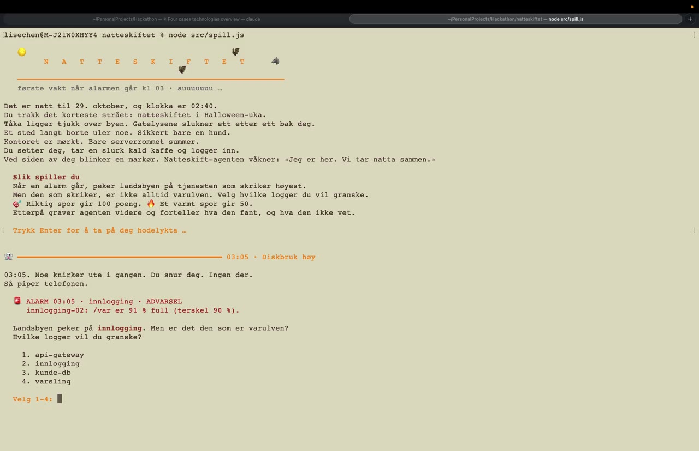

# Natteskiftet 🐺

Bygg en agent som tar første vakt når en alarm går kl 03, graver i logger og historikk, og sier ærlig hva den vet og ikke vet.

## Løsningen
Et CLI-spill, hvor man er nattevakten, og skal velge den riktige logfilen å analysere. Agenten tar over for å finne det riktige svaret etterpå.

## Demo

[](media/natteskiftet-demo.mp4)

*Klikk på bildet for å se videoen (4:38, med lyd).*

## Kom i gang

Spillet krever mac og stemmen Nora innstallert

```bash
npm install
cp .env.example .env        # lim inn ANTHROPIC_API_KEY
npm start                   # kjører eksempelalarmen (betaling kl 03:12)
npm start -- "ALARM kl 03:40: api-gateway gir 17 % 504"
```

```bash
node src/spill.js                        # full game, the agent investigates after each guess
node src/spill.js --uten-agent           # game only, no API calls (good for rehearsing)
node src/spill.js --uten-agent --fort    # same, without the typewriter effect
# add --stille to turn off Nora's voice
```